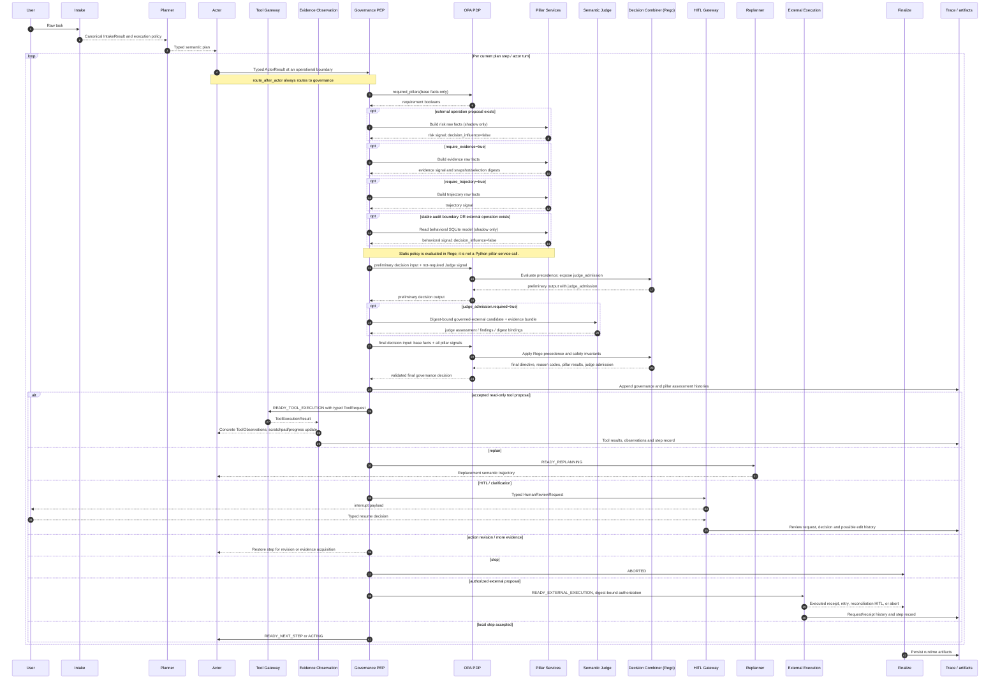

# Sequenza verificata di una richiesta governata

Il diagramma sorgente è in [`governed_request_sequence.mmd`](governed_request_sequence.mmd). Rappresenta il wiring effettivo del runtime Layer 2, compreso il ramo di `external_execution`, necessario per essere completo rispetto al codice corrente.

## Verifica del percorso

1. `build_runtime_graph` collega `START → bootstrap_from_intake → planner → actor`; `route_after_actor` restituisce sempre `governance`. Le rotte dopo governance sono `actor`, `tool_gateway`, `replanner`, `human_review`, `external_execution` oppure `finalize_bootstrap`.

2. Il PEP (`runtime/governance_service.py`) delega a `evaluate_opa_first_governance`. Prima costruisce fatti base, quindi interroga `required_pillars` in OPA. L’attivazione Rego è:

   - `PROPOSE_ACTION`: nessun pillar attivo;
   - `NEEDS_REPLAN`: solo `trajectory`;
   - `STEP_COMPLETED` locale: `evidence` e `trajectory`;
   - candidate `governed_external` non hard-denied: `evidence` e `trajectory`.

3. `risk` viene raccolto quando esiste una proposta esterna, ma è shadow-only. `behavioral` è raccolto a una frontiera di audit stabile (`waiting_human_review`/`completed`) o quando esiste una proposta esterna; è anch’esso shadow-only. Entrambi vengono inclusi nel payload, ma Rego dichiara esplicitamente che non influenzano la direttiva.

4. OPA riceve tre richieste nel caso normale: requisiti dei pillar, decisione preliminare per leggere solo `judge_admission`, decisione finale. Il judge è chiamato soltanto se l’ammissione OPA è `required=true`; deve essere un candidato esterno governato, con digest dell’operazione e digest di snapshot/selezione delle evidenze coerenti.

5. Il “Decision Combiner” non è un microservizio o una classe Python separata: è il ruolo concettuale svolto dalla precedenza Rego nel bundle OPA. Il PEP valida e applica l’output, senza ricombinare autonomamente i segnali.

6. La final directive può essere `continue`, `continue_read_only`, `request_more_evidence`, `revise_action`, `replan`, `wait_human_review`, `ask_user_clarification` oppure `stop`. Gli errori in una chiamata OPA o nella validazione del relativo contratto producono un risultato fail-closed `wait_human_review`.

7. `observe_tool_result` conserva soltanto osservazioni concrete dell’adapter (`observation_id`, contenuto, locator facoltativo), aggiorna scratchpad/progress quando trova contenuto nuovo e poi ritorna all’actor oppure, con tool request pendente, alla governance.

8. La richiesta HITL viene costruita soltanto quando il PEP porta lo stato a `WAITING_HUMAN_REVIEW`; usa `interrupt / resume`, una request ID stabile, decisioni consentite e, per proposte esterne, un payload digest-bound. Una modifica umana rigenera la proposta e ritorna obbligatoriamente a governance.

9. Per `execute_after_governance`, una proposta esterna autorizzata passa anche da `external_execution`: preflight su digest, policy envelope, registro, allowlist e idempotenza. Soltanto una ricevuta `executed` completa automaticamente il task; una ricevuta `indeterminate` richiede riconciliazione HITL.

## Trace scritto

`RuntimeArtifactStore.persist` scrive per thread:

- `full-trace-2.json` (`layer2_trace.v6`): intake, piano, ultimo actor turn, execution/scratchpad/validazioni, tool call e osservazioni, tutti i `governance_passes` (requisiti, risultati/errori dei pillar, direttiva, ragione e invarianti), HITL, comunicazione ed esecuzione esterna;
- `trace_summary.md`: vista Markdown del trace;
- `dashboard_snapshot.json` e `runtime_summary.json`;
- quando applicabile, il bundle di evidenze del judge, sia content-addressed sia come puntatore corrente.

Il trace viene materializzato dal wrapper `main_layer2.py` dopo il ritorno del grafo e durante la gestione dell’interruzione/ripresa; gli aggiornamenti di stato LangGraph sono invece checkpointed tramite lo SQLite saver.

## Punti non determinabili con certezza dal codice ispezionato

- Non è possibile dedurre dal codice una frequenza temporale universale di persistenza del trace: `RuntimeArtifactStore.persist` è invocato dai wrapper e dai percorsi di gestione, non direttamente da ogni nodo del grafo. Il checkpoint LangGraph è il meccanismo durevole tra le transizioni.
- L’ordine interno con cui OPA valuta i moduli Rego dei pillar non è osservabile come una sequenza di chiamate di processo: i moduli sono valutati nel singolo decision endpoint. Il diagramma usa “Decision Combiner (Rego)” come separazione concettuale, non come hop di rete.
- Il diagramma descrive il flusso standard con un `ActorResult`. Se `governance()` viene invocata senza `actor_result`, il servizio registra che la governance è stata saltata; il grafo normale non dovrebbe arrivarci dopo l’actor.

## Riferimenti verificati

- `src/layer2_runtime_governance/graph.py`
- `src/layer2_runtime_governance/runtime/routing.py`
- `src/layer2_runtime_governance/runtime/governance_service.py`
- `src/layer2_runtime_governance/governance_components/opa_pipeline.py`
- `src/layer2_runtime_governance/governance_components/policy_engine.py`
- `configs/opa/layer2_governance/main.rego`
- `src/layer2_runtime_governance/runtime/tool_service.py`
- `src/layer2_runtime_governance/hitl/__init__.py`
- `src/layer2_runtime_governance/runtime/external_execution_service.py`
- `src/layer4_state_evidence_observability/observability/builder.py`
- `src/layer4_state_evidence_observability/infrastructure/runtime_artifacts.py`
